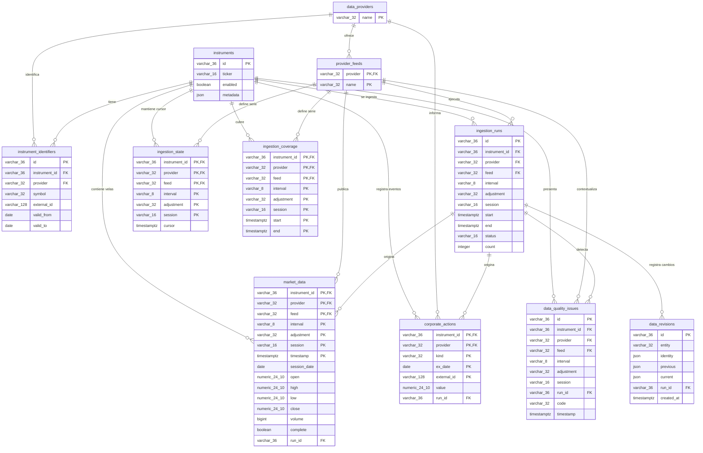

# DER — Stock Ingestion

Documento de entidad-relación del esquema PostgreSQL de `stock-ingestion`.

Exportación gráfica: [DER.svg](./DER.svg).

Fuente de verdad: [`docs/postgres-schema.sql`](./postgres-schema.sql), generado a partir del esquema SQLAlchemy y la migración `0001`. El diagrama describe las 11 tablas funcionales del dominio. `alembic_version` se documenta aparte porque es metadata interna de Alembic.

## Diagrama entidad-relación

`provider_feeds` se relaciona con las tablas de series mediante la clave compuesta `(provider, feed)`. En el diagrama se muestra como una relación con `provider_feeds`; las columnas `interval`, `adjustment` y `session` completan la identidad lógica de cada serie, pero no son claves foráneas independientes.

## Tablas y propósito

| Tabla | Propósito | Clave primaria |
| --- | --- | --- |
| `data_providers` | Catálogo de proveedores externos (`yahoo`, `alpaca`, etc.). | `name` |
| `provider_feeds` | Feeds disponibles por proveedor (`iex`, `sip`, etc.). | `(provider, name)` |
| `instruments` | Instrumentos internos administrados por el sistema. | `id` |
| `instrument_identifiers` | Mapeo temporal entre un instrumento interno y el símbolo/ID de un proveedor. | `id` |
| `ingestion_runs` | Ejecuciones o bloques de ingesta, con rango solicitado, estado y resultado. | `id` |
| `ingestion_state` | Cursor incremental por serie. | `(instrument_id, provider, feed, interval, adjustment, session)` |
| `ingestion_coverage` | Rangos de tiempo confirmados por serie. | Dimensiones de serie + `(start, end)` |
| `market_data` | Velas OHLCV y su procedencia. | Dimensiones de serie + `timestamp` |
| `corporate_actions` | Eventos corporativos, como dividendos o splits. | `(instrument_id, provider, kind, ex_date, external_id)` |
| `data_quality_issues` | Diagnósticos de huecos, datos inválidos o velas provisionales. | `id` |
| `data_revisions` | Auditoría de valores anteriores y actuales ante correcciones. | `id` |

## Claves y reglas relevantes

- Todas las columnas de dimensión (`instrument_id`, `provider`, `feed`, `interval`, `adjustment`, `session`) son obligatorias en las tablas de series.
- `market_data` identifica una vela por instrumento, proveedor, feed, intervalo, ajuste, sesión y timestamp.
- `provider_feeds` garantiza que el feed pertenece al proveedor; las tablas de series reutilizan esa integridad mediante la FK compuesta `(provider, feed)`.
- `instrument_identifiers` tiene un índice único parcial para impedir dos identificadores activos con el mismo `(provider, symbol)` (`valid_to IS NULL`).
- `market_data.volume` no puede ser negativo. Además, `low > 0`, `high >= low` y los precios de apertura/cierre deben estar dentro del rango `[low, high]`.
- `market_data`, `corporate_actions`, `data_quality_issues` y `data_revisions` conservan referencia a `ingestion_runs` para trazabilidad.
- Los campos JSON (`metadata`, `provenance`, `identity`, `previous`, `current`) almacenan información flexible del instrumento, procedencia y auditoría.

## Metadata de migraciones

`alembic_version(version_num)` es una tabla técnica de Alembic. Guarda la revisión aplicada (`0001`) y no participa del modelo de negocio ni tiene relaciones con las tablas funcionales.
